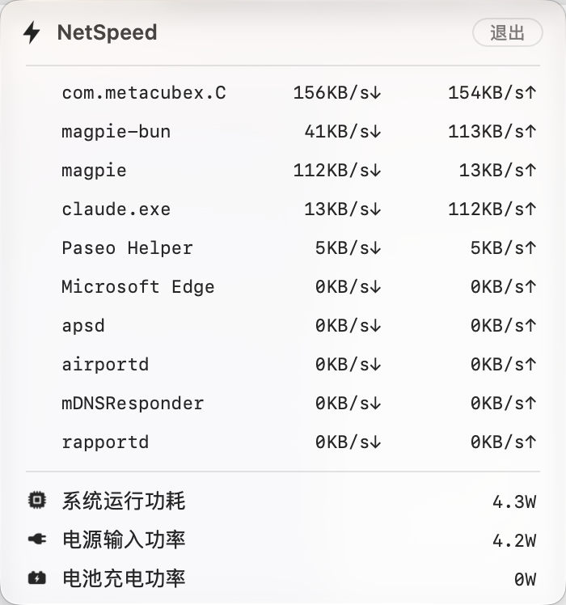

# NetSpeed

> macOS 菜单栏实时网速监控小工具 —— 显示上传/下载速率，点开查看 Top10 进程流量、整机功耗与电池充电功率。
> A lightweight macOS menu bar app that shows live upload/download speed on the status bar and per-process traffic on click.


## ✨ 功能

- **状态栏实时网速**：`↑上传 / ↓下载` 两行，每 2 秒刷新一次。
- **智能单位与精度**：KB/s 整数；`1.0~9.9MB/s` 保留 1 位小数；`≥10MB/s` 与 GB/s 用整数；状态栏预留宽度固定（不跳动、不加宽）。
- **Top10 进程流量**：点击状态栏展开菜单，按总流量排序显示前 10 个进程的上传/下载速度（方向箭头 `↓`/`↑` 与状态栏一致）。
- **功耗显示**：Top10 下方显示系统运行功耗（SMC `PSTR`）、电源输入功率（SMC `PDTR`）与电池充电功率（`AppleSmartBattery` 电压 × 电流），每 2 秒采样并做 EMA 平滑；读不到或未充电时显示 `0W`。
- **深浅色自适应文字**：进程列表文字用系统语义色 `labelColor`，浅色模式下近黑、深色模式下纯白，随系统外观自动切换；夜间深色菜单里不再发灰看不清。
- **计入 AirDrop/接力流量**：统计口径含 `awdl0`（隔空投送、接力、随航的专用直连链路），AirDrop 传文件时状态栏总速度与进程列表中的 `sharingd` 口径一致。
- **原生菜单排版**：不靠补空格对齐，改用 `NSAttributedString` + `NSParagraphStyle.tabStops` 的右对齐制表位。第一列（进程名）左对齐，第二、三列（下载/上传速度）右对齐；右对齐制表位让段落宽度恰好等于最后一个制表位的位置，菜单宽度因此天然固定，不需要额外测量补偿。不同 macOS 版本、不同字体度量下都能对齐。
- **点击即跳转**：10 个进程行点击任意一行 → 打开「活动监视器 · 网络」页；3 个功耗行点击任意一行 → 打开「活动监视器 · 能耗」页。活动监视器已在运行时只激活到前台，不改动你当前的标签页。
- **标题行**：左侧项目 logo（`docs/netspeed-logo.svg`，单色模板图，随浅色/深色外观自动着色）、NetSpeed 标题、右侧「退出」胶囊按钮（悬停高亮）。
- **轻量、无 Xcode**：单文件 Swift + `swiftc` 编译，ad-hoc 签名，不依赖额外框架。

## 🖼 菜单



状态栏显示 `124KB/s↑ / 55KB/s↓` 这类读数（KB/s 整数、小数值保留 1 位小数）。点开后：

```
【logo】NetSpeed            [退出]
────────────────────────────────
10 个进程，分三栏（名称 / 下载 / 上传）
────────────────────────────────
【芯片】系统运行功耗        4.3W
【插头】电源输入功率        4.2W
【电池】电池充电功率        0W
```

进程名与三行功耗的标签左对齐，两列速度与三个功耗数值分别右对齐到同一竖线。全部文字随系统外观自适应（浅色近黑 / 深色纯白）。

> 图标使用 SF Symbols，需要 macOS 11+（`LSMinimumSystemVersion` 已设为 12.0）。

## 🔧 环境要求

- macOS 12.0+
- Xcode Command Line Tools（提供 `swiftc`、`codesign`、`iconutil`、`hdiutil`）
  ```bash
  xcode-select --install
  ```

## 📦 构建

```bash
./build.sh              # 默认本机架构 (arm64)
./build.sh x86_64       # Intel 版（macOS 12.0+，Rosetta 下也可运行 arm64 版）
./build.sh universal    # arm64 + x86_64 + universal 三份
```

产物统一输出到 `dist/<arch>/NetSpeed.app`：

| 目录 | 架构 | 适用 |
|---|---|---|
| `dist/arm64/` | Apple Silicon | M1/M2/M3/M4/M5 及之后 |
| `dist/x86_64/` | Intel | 2012~2020 Intel Mac |
| `dist/universal/` | 双架构合并 | 一份 .app 通吃两种 Mac |

`build.sh` 会：
1. 用 `swiftc -O -target <arch>-apple-macos12.0` 编译 `main.swift`；
2. 组装 `NetSpeed.app` 包，拷入 `Info.plist` 与仓库根目录的 `AppIcon.icns`；
3. 写入版本号（见下节）；
4. ad-hoc 签名。

## 🔖 版本号

版本号由 `build.sh` 在组装 `.app` 时自动写入，**不要在 `Info.plist` 里手动维护**（那里只是无 tag 时的兜底值）：

| 字段 | 来源 | 示例 |
|---|---|---|
| `CFBundleShortVersionString` | 最近的 git tag（去掉 `v`）| `v1.1` → `1.1` |
| `CFBundleVersion` | `git rev-list --count HEAD`（提交数，单调递增）| `7` |
| `NetSpeedGitDescribe` | `git describe --tags --always --dirty`（追溯用）| `v1.1-3-g3cbad4d-dirty` |

发版流程：改代码 → 提交 → `git tag vX.Y.Z` → `git push origin main vX.Y.Z`。
推送 tag 会触发 CI 自动编译两架构并直接发布 GitHub Release（见下）；本地需要离线包时再跑 `./package_release.sh`。
未打 tag 的构建会沿用 `Info.plist` 现值，构建号仍随提交数递增，因此同版本的不同构建也能区分。

查看已安装版本的版本号：

```bash
defaults read /Applications/NetSpeed.app/Contents/Info.plist CFBundleShortVersionString
defaults read /Applications/NetSpeed.app/Contents/Info.plist NetSpeedGitDescribe
```

> CI 中 `actions/checkout` 已设 `fetch-depth: 0`，否则拿不到 tag 与提交数。

## 🚀 发布（GitHub 发布物）

### 自动发布（推荐）

`git push origin main vX.Y.Z` 推上 tag（形如 `v1.4.1`）后，CI 自动编译 → 打包 → 建 Release → 上传 assets，
Release 正文取 README「更新日志」中该版本的条目。授权用 workflow 内置的 `GITHUB_TOKEN`
（`permissions: contents: write`），**无需配置任何 secret**。非 tag 触发（main push / PR / 手动）只上传 CI 工件，不发 Release。

> 若浏览器手动上传 assets 总是失败（大文件走 S3 易超时），改用这条路径即可绕开。

### 本地打包

```bash
./package_release.sh    # 编译两架构 + zip + dmg + SHA256SUMS 一条龙
```

产出 `dist/release/`：

```
dist/release/
├── NetSpeed-<版本>-arm64.zip   # Apple Silicon 直装包（解压即用，分发首选）
├── NetSpeed-<版本>-x86_64.zip  # Intel 直装包
├── NetSpeed-<版本>-arm64.dmg   # 安装镜像（拖拽安装）
├── NetSpeed-<版本>-x86_64.dmg
└── SHA256SUMS.txt              # 校验和
```

以当前版本为例即 `NetSpeed-1.5-arm64.dmg`。

单独打 dmg：`./make_dmg.sh [arch]`（依赖 `dist/<arch>/NetSpeed.app` 已存在），dmg 卷内自带指向 `/Applications` 的链接，拖进去即完成安装。

> `.build/` 与 `dist/` 为构建产物，已加入 `.gitignore`，不入库。

## 🖼 更换应用图标

1. 用新的 `.icns` 覆盖仓库根目录的 `AppIcon.icns`；
2. 同步更新图标源（保持两者一致）：
   ```bash
   iconutil -c iconset AppIcon.icns -o Assets/AppIcon.iconset
   ```
3. 重新 `./build.sh`。若仓库中缺 `AppIcon.icns`，构建脚本会自动从 `Assets/AppIcon.iconset/` 重新生成。

## 🚀 使用方法

1. 运行后，状态栏出现网速读数（两个箭头分别表示上传/下载）。
2. 点击读数展开菜单，查看 Top10 进程的实时流量与三项功耗数据。
3. 点击任意进程行 → 打开「活动监视器 · 网络」；点击任意功耗行 → 打开「活动监视器 · 能耗」。
4. 点标题行右侧的「退出」胶囊按钮退出应用。
5. 刷新周期固定 2 秒，可在 `main.swift` 的 `refreshInterval` 调整。

## 🛠 实现要点

- **总网速采样**：`sysctl(NET_RT_IFLIST2)` 读取网卡累计收发字节数，两次采样做差除以间隔得到速率。统计口径为 `en*` 物理网卡 **+ `awdl0`**（AirDrop/接力/随航专用直连链路）；排除 `utun*`（VPN 如 ClashX TUN 的流量已在底层物理网卡计过，避免双重计数）与 `lo0`/`llw0`/`bridge0`/`anpi*`。路由消息按 `msglen` 紧凑排列，Swift 中用字节拷贝（`readLE`）读取避免未对齐 UB。
- **计数器回绕**：macOS 26 内核把接口字节计数器按 32 位写入（高 32 位恒为 0），累计值在 4.29GB（2³²）处回绕；且消息结构从 160B 变为 180B（新增字段在尾部，`ibytes@+96`/`obytes@+104` 偏移未变）。速度差分统一用 `wrapDelta32()` 低 32 位回绕减法，只要单次采样间隔流量 < 4.29GB 结果就完全正确（也兼容老系统真 64 位计数器）。
- **Top10 进程流量**：每轮调用 `nettop -P -L 1 -x -n` 获取各进程累计入/出字节，与上一次快照做差求速度；在后台线程执行，不阻塞主线程。进程统计与接口无关，因此 AirDrop 由 `sharingd` 承载、会出现在列表中。注意 nettop 的进程累计值是真 64 位但**不单调**（连接关闭时统计会回退），做差需钳位为 0。
- **功耗与充电功率**：通过 IOKit `AppleSMC` 用户客户端读取 `PSTR`（系统运行功耗）与 `PDTR`（电源输入功率），免 root；key 缺失或数值异常时按 0W 处理。电池充电功率读取 `AppleSmartBattery` 的 `Voltage × Amperage`，未充电时固定 0W（Apple Silicon 的 SMC `PPBR` 是电池放电轨读数，充电时不可靠）。三项均 2 秒采样并用 EMA（α=0.3）平滑，避免数字跳动。
- **状态栏渲染**：把上下两行文字画成 `NSImage`，文字右对齐、箭头贴右缘固定，并显式设 `statusItem.length` 消除系统默认 padding，保证宽度恒定不跳动。
- **菜单对齐与配色**：全部使用原生 `NSMenuItem` + `attributedTitle`，对齐交给 `NSParagraphStyle.tabStops`（第二、三列右对齐制表位），不再用补空格的方式。右对齐制表位的段落宽度等于最后一个制表位位置，菜单宽度因此天然固定。文字统一用语义色 `labelColor`（浅色近黑 / 深色纯白），随系统外观自动切换。
- **菜单图标**：菜单项的 `image` 槽位不渲染 SF Symbol 的矢量表示，必须栅格化成位图；而符号自带大量内边距（`bolt.fill` 在 13pt 画布里图形只有约 4×6pt），直接缩放会显得很小。做法是先高分辨率渲染、量出墨迹边界、裁掉留白再放大到目标尺寸。画布固定 16pt（系统图标槽宽度），只缩放墨迹，这样图标大小可以独立调整而不会让标题列左移。
- **标题行 logo**：`docs/netspeed-logo.svg` 是单色形状（白→#CCCCCC 渐变），因此不需要单独的深色资源，而是当作模板图在绘制时染成 `labelColor`——浅色外观下自动变深、深色下自动变白。模板图只有在系统控件内部才会被自动着色，自绘时必须自己处理，否则浅色菜单里会因保持白色而看不见。
- **活动监视器跳转**：活动监视器没有切换标签页的命令行参数，且只在**启动时**读取 `SelectedTab` 偏好（0=CPU 1=内存 2=能耗 3=磁盘 4=网络）。因此策略是：未运行 → 先写偏好再启动，保证落在目标页；已运行 → 只激活到前台，不打扰用户当前状态。

## 🔍 调试

```bash
dist/arm64/NetSpeed.app/Contents/MacOS/NetSpeed --debug-bytes
# 输出 rx=... tx=...（累计字节数），可与 `netstat -ib` 的 en*+awdl0 合计对账。
# 注意 macOS 26 上该值会在 4.29GB 处回绕（内核行为），对账请比较差分而非绝对值。

# 功耗对账：连续打印 5 次 PSTR/PDTR 与电池充电功率
dist/arm64/NetSpeed.app/Contents/MacOS/NetSpeed --debug-power
```

## 📁 项目结构

```
NetSpeed/
├── main.swift            # 全部源码（采样/格式化/状态栏渲染/菜单/定时刷新）
├── build.sh              # 构建脚本（支持 arm64/x86_64/universal 参数）
├── make_dmg.sh           # 打包 .dmg 安装镜像（hdiutil）
├── package_release.sh    # 一键产出 GitHub 发布物（zip + dmg + SHA256，文件名带版本）
├── Info.plist            # 应用元数据（LSUIElement 状态栏应用；版本号由 build.sh 覆写）
├── AppIcon.icns          # 应用图标（与 Assets/AppIcon.iconset 同源）
├── Assets/
│   └── AppIcon.iconset/  # 图标源多尺寸 PNG
├── dist/                 # 构建产物（不入库）
│   ├── arm64|x86_64|universal/NetSpeed.app
│   └── release/          # GitHub 发布物（zip/dmg/SHA256SUMS.txt）
├── docs/
│   ├── netspeed-logo.svg # 菜单标题行 logo（单色模板图，构建时拷入 app bundle）
│   └── screenshots/      # README 截图
├── .github/workflows/    # 构建 CI：push/PR 上传工件；推 `v*` tag 时自动发布 GitHub Release
└── .gitignore
```

## 📜 更新日志

- **1.5（2026-10-23）**：菜单排版改为**全原生**实现，不再靠补空格对齐——改用 `NSAttributedString` + 右对齐制表位，修复了在 Intel / macOS 15 上图标与文字错位的问题，菜单宽度也天然固定；字体改用系统 SF Mono（不再依赖本机安装 JetBrains Mono）。顶部新增标题行：项目 logo + NetSpeed + 右侧「退出」胶囊按钮（悬停高亮），并加回标题行下方的分隔线；logo 作为模板图随浅色/深色外观自动着色。删除底部「打开活动监视器 / 退出 NetSpeed」两行及其分隔线。10 个进程行点击 → 活动监视器「网络」页，3 个功耗行点击 → 「能耗」页（已运行时只激活，不切页）。「系统运行功耗」图标由闪电改为芯片 `cpu.fill`，与项目 logo 区分；三行功耗图标缩小到不超过文字高度。README 插图更新为当前界面。
- **1.4.1（2026-10-22）**：功耗信息细化——「系统总功耗」更名为「系统运行功耗」，「电源总功耗」更名为「电源输入功率」，并新增第三行「电池充电功率」（SF Symbols `bolt.batteryblock.fill` 实心电池块 + 闪电图标，读取 `AppleSmartBattery` 的电压 × 电流，未充电时显示 `0W`）；三行图标、字号、行距与数值对齐完全一致。
- **1.4（2026-10-22）**：新增整机功耗显示——Top10 下方新增系统总功耗（SMC `PSTR`）与电源总功耗（SMC `PDTR`）两条数据行及分隔线，2 秒采样 + EMA 平滑，读不到时显示 `0W`。底部"打开活动监视器 / 退出 NetSpeed"图标改为面性风格（`waveform.path.ecg.rectangle.fill` / `power.circle.fill`）；功耗行行距对齐原生菜单项 24pt、标签 13pt，数值改用 JetBrains Mono 11pt；新增 `--debug-power` 调试开关。
- **1.3.1（2026-10-09）**：状态栏 ↑/↓ 箭头由彩色（`.systemRed`/`.systemBlue`）改为与数值同色 `.labelColor`——深色菜单栏为白、浅色菜单栏为黑，随系统外观自适应，两行视觉统一。
- **1.3（2026-10-02）**：固定 Top10 菜单宽度——进程名列在菜单打开瞬间按当时最宽名字钉住，打开期间重填沿用；速度两列按最坏情况（`999MB/s`）恒定预留，文字右对齐向左扩展，箭头贴右缘不动，菜单宽度不再逐帧抖动。
- **1.2（2026-09-28）**：进程列表文字由 `.secondaryLabelColor` 改为 `.labelColor`——修复系统深色模式下 10 个进程文字发灰、对比度不足看不清的问题（深色纯白、浅色近黑，与底部功能项同色）；浅色模式下文字也由 50% 黑加深到 85% 黑。
- **1.1（2026-09-17）**：修复 `beginActivity` 选项误用 `.userInitiated` 导致整机永不空闲睡眠的问题（改为 `.userInitiatedAllowingIdleSystemSleep`，并在退出时成对调用 `endActivity`）；版本号改由 `build.sh` 从 git tag 自动写入，发布物文件名带版本号。
- **2026-09-16**：总网速计入 `awdl0`（修复 AirDrop/接力流量不显示）；修复计数器 4.29GB 回绕导致的速度显示假 0（接口与进程两处差分均改为回绕减法）；新增 `--debug-bytes` 调试开关；构建脚本支持架构参数，产物统一到 `dist/`；换用新图标；新增 x86_64/universal 构建。

## 📄 License

Released under the [MIT License](LICENSE).

## 🙏 致谢

- 图标素材由 [作者] 制作。
